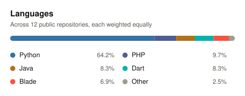

<picture>
  <source media="(prefers-color-scheme: dark)" srcset="https://raw.githubusercontent.com/rzkydell/rzkydell/main/assets/banner-dark.svg">
  <source media="(prefers-color-scheme: light)" srcset="https://raw.githubusercontent.com/rzkydell/rzkydell/main/assets/banner-light.svg">
  
</picture>

  
  
  

### Hi, I'm Rizky

I'm a **Full Stack Developer at [PT Kawasan Industri Nusantara (KINRA)](https://seimangkeisez.com)**, the operator of the Sei Mangkei Special Economic Zone in North Sumatra, Indonesia. I build the company's internal software end to end: sitting with the people who run the process, designing the data and the interface, then building, testing, shipping and maintaining it.

Before KINRA, my work was in **AI and smart agriculture**: computer vision for oil palm (disease, health and ripeness), yield forecasting, and IoT prototypes for plantations. I graduated in Information Systems & Technology from Institut Teknologi Sawit Indonesia (ITSI) in June 2026, GPA 3.79.

<b>Versi Bahasa Indonesia</b>

 

Halo, saya Rizky, **Full Stack Developer di PT Kawasan Industri Nusantara (KINRA)**, pengelola KEK Sei Mangkei, Sumatera Utara. Saya membangun perangkat lunak internal perusahaan dari ujung ke ujung, mulai dari memahami alur kerja bersama pemilik proses, merancang data dan antarmuka, hingga rilis dan pemeliharaan. Latar belakang saya adalah AI dan pertanian cerdas: computer vision untuk kelapa sawit, prediksi hasil panen, dan prototipe IoT perkebunan. Lulusan S1 Sistem & Teknologi Informasi, Institut Teknologi Sawit Indonesia (Juni 2026, IPK 3,79).

### Currently

- **One front door for every app.** A single sign-on and identity console for KINRA's internal apps, with shared organisational data, per-app access, one notification hub (including Web Push) and live refresh after each release.
- **Operations apps on top of it.** Fleet & energy (with AI-assisted meter reading), corporate secretariat (meeting rooms, company calendar, QR-verifiable catering evidence), digital correspondence with multi-level disposition, and an IT helpdesk driven by an SLA catalogue.
- **The Sei Mangkei SEZ website.** A three-language, SEO-ready rebuild with its own CMS, currently pre-launch.

Built with Next.js, TypeScript and Supabase, shipped in stages from testing to production with Docker. These are company systems, so the code is private; outlines are on [my portfolio](https://rzkydell.vercel.app/en#work).

### Tech stack

  <picture>
    <source media="(prefers-color-scheme: dark)" srcset="https://raw.githubusercontent.com/rzkydell/rzkydell/main/assets/stack-web-dark.svg">
    
  </picture>
   
  <picture>
    <source media="(prefers-color-scheme: dark)" srcset="https://raw.githubusercontent.com/rzkydell/rzkydell/main/assets/stack-ai-dark.svg">
    
  </picture>
   
  <picture>
    <source media="(prefers-color-scheme: dark)" srcset="https://raw.githubusercontent.com/rzkydell/rzkydell/main/assets/stack-tools-dark.svg">
    
  </picture>

Also: Filament, Streamlit, Ultralytics YOLO & RT-DETR, OpenAI and Gemini APIs, PWA & Web Push, Playwright, QGIS, n8n.

### Featured projects

| Project | What it does | Stack |
| --- | --- | --- |
| [**Crop Yield Prediction (LSTM)**](https://github.com/rzkydell/Crop-Yield-Prediction-Using-LSTM) | Forecasts oil palm yield (t/ha) per block from 12 months of history and lagged rainfall, with a Streamlit calculator for non-technical users. 18.45% MAPE on 80 held-out sequences. | Python · TensorFlow · Streamlit |
| [**ESG Monitoring for Palm Oil**](https://github.com/rzkydell/ESG_PalmOil) | Field reports with AI-assisted risk analysis, an RSPO/ISPO compliance matrix, carbon intensity per ton of FFB, a public whistleblowing form, corrective actions and an audit trail. | Laravel 12 · Filament · Gemini API |
| [**Inventory System, PTPN IV Adolina**](https://github.com/rzkydell/Inventory-Management-System---PTPN-IV-Adolina) | Desktop warehouse app: barcode scanning with a phone camera, stock in/out and stock opname, role-based access, Excel/PDF reports, stock-out forecast and a read-only AI assistant. | Python · PySide6 · SQLite |
| [**Fatigue Level Detection (RT-DETR)**](https://github.com/rzkydell/Fatigue-Level-Detection-using-RT-DETR) | Real-time webcam detection of normal, moderate and severe fatigue, smoothed over frames by a small state machine and recorded to video. | Python · RT-DETR · OpenCV |
| [**Oil Palm Fruit Ripeness**](https://github.com/rzkydell/kematangan-buah-sawit) | Detects fresh fruit bunches in six ripeness classes, from unripe to overripe and empty bunches, with a custom-trained YOLOv5 model. | Python · YOLOv5 · PyTorch |
| [**Oil Palm Health from Aerial Images**](https://github.com/rzkydell/Klasifikasi_Kesehatan_KelapaSawit) | Flags healthy and unhealthy palms in aerial imagery of plantation blocks with a custom-trained YOLOv5 model. | Python · YOLOv5 · PyTorch |

More experiments, including a Flutter fertiliser calculator, a Java field-supervisor report app and a library CMS, are in [my repositories](https://github.com/rzkydell?tab=repositories).

### Publications

- **Performance Evaluation of YOLOv9, YOLOv10, and YOLOv11 for Real-Time Early Detection of Ganoderma Boninense in Oil Palm**\
  Jurnal RESTI (Rekayasa Sistem dan Teknologi Informasi), Vol. 10 No. 2, 2026 · Q3 · [doi:10.29207/resti.v10i2.7479](https://doi.org/10.29207/resti.v10i2.7479)
- **Mapping and Development of Railway Station Website in West Sumatra Province Using QGIS and GitHub**\
  Jurnal IPTEK Bagi Masyarakat (J-IBM), Vol. 4 No. 1, 2024 · SINTA 3 · [doi:10.55537/jibm.v4i1.909](https://doi.org/10.55537/jibm.v4i1.909)

### GitHub activity

<picture>
  <source media="(prefers-color-scheme: dark)" srcset="https://raw.githubusercontent.com/rzkydell/rzkydell/output/snake-dark.svg">
  
</picture>

  
  

  

Generated daily in this repository by GitHub Actions with <a href="https://github.com/lowlighter/metrics">lowlighter/metrics</a> and <a href="https://github.com/Platane/snk">Platane/snk</a>. Stack icons from <a href="https://github.com/tandpfun/skill-icons">skill-icons</a> (MIT).

---

  Happy to talk about information systems, digital transformation in industry, and AI research for the plantation sector. 
  <a href="mailto:rizkydelianngi@gmail.com">rizkydelianngi@gmail.com</a> · <a href="https://rzkydell.vercel.app">rzkydell.vercel.app</a>

